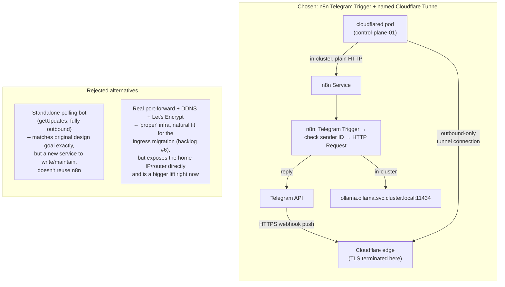

# ADR 0019: Telegram Bot via n8n's Webhook Trigger, Exposed Through a Named Cloudflare Tunnel

**Status:** Accepted
**Date:** 2026-08-30
**Related to:** [ADR 0012](0012-comfyui-public-tunnel-security-incident.md) (the tunnel incident this deliberately contrasts with), [ADR 0009](0009-nodeport-then-traefik-ingress.md) (this platform's general exposure philosophy), backlog #16/#17 (the n8n instance and hybrid-reasoning workflow this builds on), backlog #18 (the item this closes)

## Context

Backlog #18 was originally scoped as: *"a bot would poll/connect outbound to Telegram's API from inside the cluster and call Ollama's internal Service directly, so no inbound port-forwarding, dynamic DNS, or public TLS cert is needed on the home network."* That framing assumed **long-polling** (`getUpdates`) — a purely outbound access pattern.

Once #16/#17 stood up a working n8n instance, reusing it for the Telegram bot (Telegram Trigger node → call Ollama → reply) looked like the fastest path — no new service to write or maintain. But n8n's Telegram integration only supports **webhooks**: it calls Telegram's `setWebhook` API and Telegram's servers then push messages to n8n over HTTPS. That is fundamentally a push/inbound model, not the outbound-only polling the backlog description assumed. Discovered during implementation, not planned for up front.

So the real decision is two-layered:

1. **n8n's Telegram Trigger (webhook, inbound) vs. a standalone polling script (outbound-only, no n8n)** — reuse the existing platform investment vs. stay true to the original zero-inbound-exposure design goal.
2. **If webhook: how is the public HTTPS endpoint provided** — a real router port-forward + dynamic DNS + Let's Encrypt cert, vs. a Cloudflare Tunnel.

## Decision

Keep the n8n Telegram Trigger (accept the inbound-webhook requirement), and expose it via a **named Cloudflare Tunnel** (`cloudflared`) rather than a real port-forward.

## Rationale

- **Reuses the n8n instance from #16/#17** rather than standing up a new standalone service — less to build and maintain, and the hybrid-reasoning workflow pattern already validated there (local triage, escalate when needed) is directly reusable for a Telegram-facing assistant later.
- **Cloudflare Tunnel keeps the home network's actual inbound surface at zero.** `cloudflared` makes an *outbound* connection from `control-plane-01` to Cloudflare's edge; Cloudflare terminates TLS and forwards over that existing tunnel. No router port-forward, no home IP exposed publicly, no dynamic DNS needed.
- **This is not a repeat of ADR 0012.** That incident was an *unrequested*, auto-generated "quick tunnel" from a vendor image (`ai-dock/comfyui`), gated by a well-known literal default password (`"password"`), discovered by accident in startup logs. This is a **named tunnel**, deliberately created under Deepesh's own Cloudflare account, with credentials scoped to one specific ingress hostname routing only to n8n's internal Service — and n8n itself adds a second gate on top, checking the incoming Telegram sender's numeric user ID before doing anything (see Consequences).
- The "proper infra" alternative (real port-forward + DDNS + Let's Encrypt via Traefik Ingress) is deliberately deferred to backlog #6's Ingress migration, not built one-off just for this bot — doing it generally, later, for every app that needs LAN *and* public exposure is a better use of that effort than a single-purpose cert just for Telegram.

## Consequences

- Requires a domain added to a (free-tier) Cloudflare account — not previously needed anywhere on this platform. One-time setup, done by Deepesh directly (browser-based `cloudflared tunnel login` OAuth flow isn't something that can be scripted/delegated).
- Adds `cloudflared` as a new always-on component and a new point of public reachability, even though narrowly scoped — worth including in future "what's actually running/exposed" audits (same practice ADR 0012's Consequences established for `comfyui`).
- **Access control is two-layered, and both layers matter:** the tunnel's ingress config only routes one hostname to n8n's Service (nothing else on the cluster becomes reachable through it), and the n8n workflow itself must reject any Telegram message whose sender ID doesn't match Deepesh's own numeric ID — a bare bot token alone is not access control, since anyone who finds the bot's username could otherwise message it.
- `N8N_WEBHOOK_URL` (currently the internal NodePort address, `infra/k8s/base/n8n/02-n8n.yaml`) needs to point at the new public tunnel hostname instead, so n8n registers the correct externally-reachable URL with Telegram's `setWebhook` call. The NodePort URL keeps working for LAN admin access to the editor UI regardless.

## Follow-ups

- [ ] Register/obtain a domain and add it to a Cloudflare account (Deepesh, browser-based)
- [ ] `cloudflared tunnel login`, `cloudflared tunnel create`, and `cloudflared tunnel route dns` for a dedicated webhook hostname (e.g. `n8n-webhook.<domain>`)
- [ ] Deploy `cloudflared` as a Deployment on `control-plane-01` (credentials via a Secret, not committed), routing that hostname to n8n's internal Service
- [ ] Update `N8N_WEBHOOK_URL` in `infra/k8s/base/n8n/02-n8n.yaml` to the public tunnel hostname
- [ ] Build the Telegram workflow in n8n: Telegram Trigger → IF sender ID matches Deepesh's Telegram user ID → HTTP Request to Ollama → reply; silently drop anything from any other sender
- [ ] Confirm end-to-end from a phone on cellular data (not the home Wi-Fi) — the actual point of backlog #18
